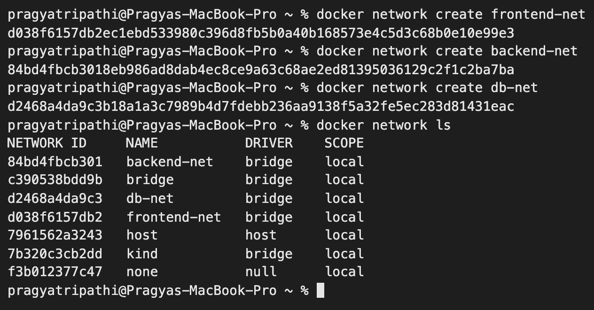
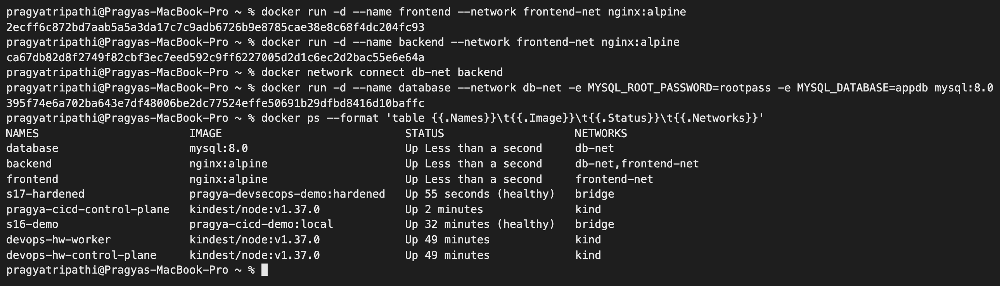
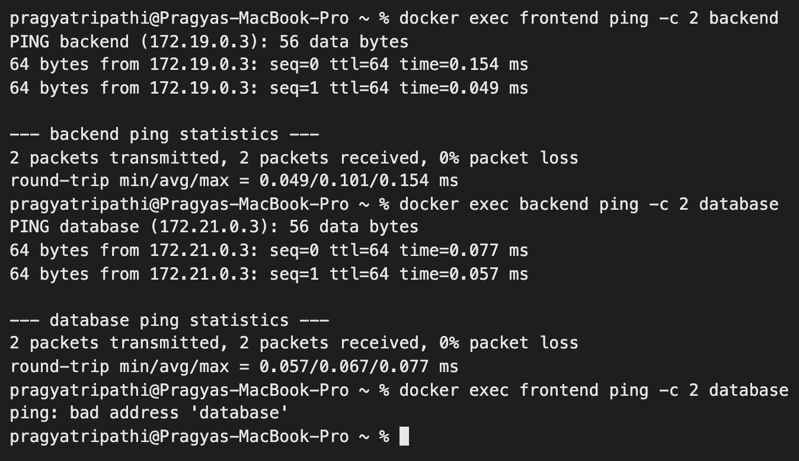
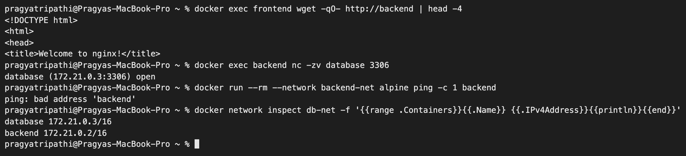
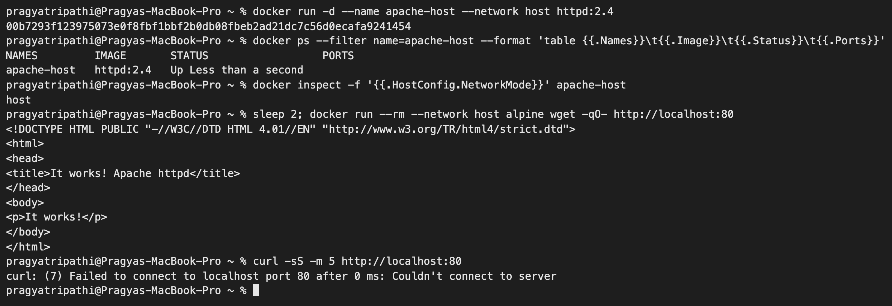
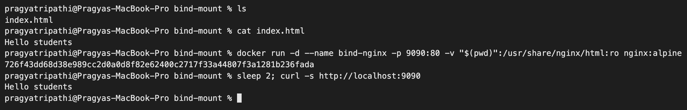
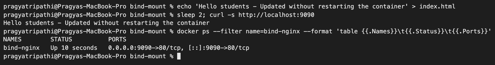

# Docker Networking & Volumes – Homework

**Name:** Pragya Tripathi
**Roll No:** 24BCS10032

All outputs are copied from my terminal (Docker Desktop on macOS).

---

## Task 1: Docker container networking

**Goal:** 3 containers (frontend, backend, database), 3 networks, backend attached to 2 networks, then check connectivity.

### Design

```text
   frontend-net                 db-net                  backend-net
+----------------+        +----------------+        +----------------+
| frontend       |        | database       |        | (no app here,  |
| backend  <-----+--------+-> backend      |        |  used to prove |
+----------------+        +----------------+        |  isolation)    |
                                                    +----------------+
```

- `frontend` (nginx:alpine) → `frontend-net`
- `backend` (nginx:alpine) → `frontend-net` **and** `db-net` (2 networks)
- `database` (mysql:8.0) → `db-net`
- `backend-net` is the third network. A throw-away container is started on it to show that a container on a different network cannot reach the others.

This is the usual 3-tier idea: the frontend must never talk to the database directly, only the backend can.

### Create the networks and containers

Image pull progress lines are removed from the output.

```text
$ docker network create frontend-net
5b82cd7c4087711245d8d730b4b96e808272d08a3507e12e511b85c7e06eb9d2

$ docker network create backend-net
1aa3711869951948c605aa84f12114684683c8ef08a315f9e4a554b2bb6d8cd8

$ docker network create db-net
758f9ce6be152915417e086e2276cb226132813a4a840b7f615a43e8db411194

$ docker network ls --filter name=-net
NETWORK ID     NAME           DRIVER    SCOPE
1aa371186995   backend-net    bridge    local
758f9ce6be15   db-net         bridge    local
5b82cd7c4087   frontend-net   bridge    local

$ docker run -d --name frontend --network frontend-net nginx:alpine
Unable to find image 'nginx:alpine' locally
alpine: Pulling from library/nginx
Digest: sha256:c8497b180665e631ec92a5091125bec5b214f0e2b99409e30653a125b37557da
Status: Downloaded newer image for nginx:alpine
2ef70326be864f727c019d49fc86f5d371dac0144a56a67888b5b2bf2a8d50ac

$ docker run -d --name backend --network frontend-net nginx:alpine
3041eb99d0b695294db19460edd8c8ecfb42fcfee5272d816ba2f743d0d55f6b

$ docker network connect db-net backend

$ docker run -d --name database --network db-net -e MYSQL_ROOT_PASSWORD=rootpass -e MYSQL_DATABASE=appdb mysql:8.0
Unable to find image 'mysql:8.0' locally
8.0: Pulling from library/mysql
Digest: sha256:7dcddc01f13bab2f15cde676d44d01f61fc9f99fe7785e86196dfc07d358ae2b
Status: Downloaded newer image for mysql:8.0
d7effeafa4f289126ba57bb235b3cea9a1e0bf79462feb269afdceb6efc7b5a8

$ docker inspect -f '{{.Name}} -> {{range $k,$v := .NetworkSettings.Networks}}{{$k}}={{$v.IPAddress}} {{end}}' frontend backend database
/frontend -> frontend-net=172.19.0.2
/backend -> db-net=172.21.0.2 frontend-net=172.19.0.3
/database -> db-net=172.21.0.3
```

### Check connectivity

```text
$ docker exec frontend ping -c 2 backend
PING backend (172.19.0.3): 56 data bytes
64 bytes from 172.19.0.3: seq=0 ttl=64 time=0.145 ms
64 bytes from 172.19.0.3: seq=1 ttl=64 time=0.175 ms

--- backend ping statistics ---
2 packets transmitted, 2 packets received, 0% packet loss
round-trip min/avg/max = 0.145/0.160/0.175 ms

$ docker exec backend ping -c 2 frontend
PING frontend (172.19.0.2): 56 data bytes
64 bytes from 172.19.0.2: seq=0 ttl=64 time=0.068 ms
64 bytes from 172.19.0.2: seq=1 ttl=64 time=0.167 ms

--- frontend ping statistics ---
2 packets transmitted, 2 packets received, 0% packet loss
round-trip min/avg/max = 0.068/0.117/0.167 ms

$ docker exec backend ping -c 2 database
PING database (172.21.0.3): 56 data bytes
64 bytes from 172.21.0.3: seq=0 ttl=64 time=0.145 ms
64 bytes from 172.21.0.3: seq=1 ttl=64 time=0.133 ms

--- database ping statistics ---
2 packets transmitted, 2 packets received, 0% packet loss
round-trip min/avg/max = 0.133/0.139/0.145 ms

$ docker exec frontend ping -c 2 -W 2 database
ping: bad address 'database'

$ docker exec frontend wget -qO- http://backend | head -5
<!DOCTYPE html>
<html>
<head>
<title>Welcome to nginx!</title>
<style>

$ docker exec backend nc -zv database 3306
database (172.21.0.3:3306) open

$ docker run --rm --network backend-net alpine sh -c "ping -c 1 -W 2 backend; ping -c 1 -W 2 database"
Unable to find image 'alpine:latest' locally
latest: Pulling from library/alpine
Digest: sha256:28bd5fe8b56d1bd048e5babf5b10710ebe0bae67db86916198a6eec434943f8b
Status: Downloaded newer image for alpine:latest
ping: bad address 'backend'
ping: bad address 'database'

$ docker network inspect frontend-net -f "{{range .Containers}}{{.Name}} {{.IPv4Address}}{{println}}{{end}}"
frontend 172.19.0.2/16
backend 172.19.0.3/16

$ docker network inspect db-net -f "{{range .Containers}}{{.Name}} {{.IPv4Address}}{{println}}{{end}}"
backend 172.21.0.2/16
database 172.21.0.3/16

$ docker exec database mysql -uroot -prootpass -e "SHOW DATABASES;"
mysql: [Warning] Using a password on the command line interface can be insecure.
Database
appdb
information_schema
mysql
performance_schema
sys
```

### The default bridge behaves differently

Everything above runs on **user-defined** networks. The `bridge` network Docker gives a container when you pass no `--network` at all is not the same thing, and the difference is name resolution.

```text
$ docker run -d --name dflt-a nginx:alpine   # no --network, so the default bridge
345d78fe98090ac05be572829af8a0e937eb4d41c8226c0014f77c4d5e57067e

$ docker run -d --name dflt-b nginx:alpine
f9e832eca18e1083fe9d99d616a9b720ea84dbc88c5ea5ff4fed531d34844cde

$ docker inspect -f '{{.Name}} {{.HostConfig.NetworkMode}} {{range $k,$v := .NetworkSettings.Networks}}{{$k}}={{$v.IPAddress}}{{end}}' dflt-a dflt-b
/dflt-a bridge bridge=172.17.0.2
/dflt-b bridge bridge=172.17.0.3

$ docker exec dflt-a ping -c 2 -W 2 dflt-b   # by NAME
ping: bad address 'dflt-b'
exit status: 1

$ docker exec dflt-a ping -c 2 172.17.0.3   # same pair, by IP
PING 172.17.0.3 (172.17.0.3): 56 data bytes
64 bytes from 172.17.0.3: seq=0 ttl=64 time=0.192 ms
64 bytes from 172.17.0.3: seq=1 ttl=64 time=0.170 ms

--- 172.17.0.3 ping statistics ---
2 packets transmitted, 2 packets received, 0% packet loss
```

The two containers are on the same subnet and reach each other **by IP**, but the name does not resolve. On a user-defined network the identical test works:

```text
$ docker network create demo-udn
d3d3f13f5064108d8ffb3bf3d34f27073e8218b5de89a1cffeaff61151ce02f5

$ docker run -d --name udn-a --network demo-udn nginx:alpine && docker run -d --name udn-b --network demo-udn nginx:alpine
23a1c042cc0884701263a2cd704ab66250b7b17299d40fe3776bd95b6ec73c28
fddd092b02ce1956ea39001a4d16e61d8e05c85c6b23f6887786c550b970cbd5

$ docker exec udn-a ping -c 2 udn-b   # by NAME
PING udn-b (172.20.0.3): 56 data bytes
64 bytes from 172.20.0.3: seq=0 ttl=64 time=0.238 ms
64 bytes from 172.20.0.3: seq=1 ttl=64 time=0.069 ms

--- udn-b ping statistics ---
2 packets transmitted, 2 packets received, 0% packet loss
```

`/etc/resolv.conf` shows exactly why:

```text
$ docker exec udn-a cat /etc/resolv.conf
nameserver 127.0.0.11
options ndots:0

$ docker exec dflt-a cat /etc/resolv.conf
nameserver 192.168.65.7
```

A container on a user-defined network is pointed at **127.0.0.11**, Docker's embedded DNS server, which knows every container name on that network. A container on the default bridge is pointed straight at the host's upstream resolver, which has never heard of `dflt-b`. The old way to make names work on the default bridge was `--link`, which is deprecated. This is the practical reason to always create a network rather than relying on the default.

### Screenshots

The screenshots were taken in a second run of the same commands, so container IDs differ from the text output above.

Networks created:



Containers, with `backend` on two networks:



Ping tests (frontend → database fails as expected):



HTTP, MySQL port and isolation tests:



### Result

| From → To | Result | Why |
|---|---|---|
| frontend → backend | Works | Both are on `frontend-net` |
| backend → frontend | Works | Both are on `frontend-net` |
| backend → database (ping and port 3306) | Works | Both are on `db-net` |
| frontend → database | **Fails** (`bad address`) | No shared network, so not even the name resolves |
| container on `backend-net` → backend / database | **Fails** | Different network, fully isolated |

### What I understood

- User-defined bridge networks have a built-in DNS server, so containers reach each other by **container name**. The default `bridge` network does not do this.
- A container can join several networks with `docker network connect`. It then gets one IP per network (`backend` has `172.19.0.3` and `172.21.0.2`).
- Networks are isolation boundaries. Two containers can only talk if they share at least one network.

Clean up:

```bash
docker rm -f frontend backend database
docker network rm frontend-net backend-net db-net
```

---

## Task 2: Host network

**Goal:** run Apache with `--network host` and access it directly on port 80, without `-p`.

```text
$ docker pull -q httpd:2.4
docker.io/library/httpd:2.4

$ docker run -d --name apache-host --network host httpd:2.4
c48b22d25eadc254475bb112c5e9a82f9b26cc787997b8b186fb875d93fc1a43

$ docker ps --filter name=apache-host --format "table {{.Names}}	{{.Image}}	{{.Status}}	{{.Ports}}"
NAMES         IMAGE       STATUS         PORTS
apache-host   httpd:2.4   Up 3 seconds

$ docker inspect -f '{{.HostConfig.NetworkMode}}' apache-host
host
```

`PORTS` is empty because nothing is published. With the host network the container shares the network stack of the Docker host, so Apache binds straight to port 80 of the host.

### Accessing the website on port 80

```text
$ sleep 2; docker run --rm --network host alpine wget -qO- http://localhost:80
<!DOCTYPE HTML PUBLIC "-//W3C//DTD HTML 4.01//EN" "http://www.w3.org/TR/html4/strict.dtd">
<html>
<head>
<title>It works! Apache httpd</title>
</head>
<body>
<p>It works!</p>
</body>
</html>
```

Apache answered with **It works!** on `localhost:80` of the Docker host, with no port mapping.

### An important detail on macOS

```text
$ curl -sS -m 5 http://localhost:80; echo "curl exit code: $?"
curl: (7) Failed to connect to localhost port 80 after 0 ms: Couldn't connect to server
curl exit code: 7
```

From the macOS terminal the same URL is refused. On macOS (and Windows) Docker runs inside a small Linux virtual machine, so with `--network host` the "host" is that **Linux VM, not my Mac**. That is why I tested from a second container that also uses the host network. On a real Linux machine `curl http://localhost:80` works directly from the terminal and the browser. Newer Docker Desktop versions also have an optional "Enable host networking" setting that forwards these ports to the Mac.

### Screenshot



### What I understood

- `--network host` removes network isolation. There is no separate container IP, no NAT, and `-p` is ignored.
- It is slightly faster and useful for monitoring agents, but two containers cannot both use the same port, and it is less secure.

---

## Task 3: Bind mount

**Goal:** serve a local folder through Nginx and see edits live without restarting the container.

Folder: [bind-mount](bind-mount) containing `index.html`.

```text
$ cat index.html
Hello students

$ docker run -d --name bind-nginx -p 9090:80 -v "$(pwd)":/usr/share/nginx/html:ro nginx:alpine
6d140189fa7495088a41f7b290c25996b49bd7051e8b8b47ee3ebedaf56012ee

$ curl -s http://localhost:9090
Hello students

$ echo "Hello students - Updated without restarting the container" > index.html

$ curl -s http://localhost:9090
Hello students - Updated without restarting the container

$ docker exec bind-nginx cat /usr/share/nginx/html/index.html
Hello students - Updated without restarting the container

$ docker inspect -f '{{range .Mounts}}{{.Type}} {{.Destination}} rw={{.RW}}{{end}}' bind-nginx
bind /usr/share/nginx/html rw=false

$ docker ps --filter name=bind-nginx --format "table {{.Names}}	{{.Status}}	{{.Ports}}"
NAMES        STATUS         PORTS
bind-nginx   Up 4 seconds   0.0.0.0:9090->80/tcp, [::]:9090->80/tcp
```

### Screenshots

Container started with the bind mount:



Browser at `http://localhost:9090` before the edit:


File edited on the laptop, container not restarted:



Browser after the edit:


### The `:ro` flag is enforced

`rw=false` in the inspect output is a claim; this is the test. Same folder and the same `:ro` flag, run as a second container (`ro-demo`, published on 9091) so that `bind-nginx` above kept serving.

```text
$ docker run -d --name ro-demo -p 9091:80 -v "$(pwd)":/usr/share/nginx/html:ro nginx:alpine
1715ea39511f4c5c5eb0c43ff1dc8485c1caab3452e5338d5885e8b39ba0456a
```

```text
$ docker exec ro-demo sh -c 'echo tampered > /usr/share/nginx/html/index.html'
sh: can't create /usr/share/nginx/html/index.html: Read-only file system
exit status: 1

$ docker exec ro-demo touch /usr/share/nginx/html/newfile.txt
touch: /usr/share/nginx/html/newfile.txt: Read-only file system
exit status: 1

$ ls   # on the laptop - nothing was created
index.html
```

The kernel refuses both the overwrite and the new file. Edits still flow **in** from the laptop, as shown above — `:ro` restricts the container, not me. For a web server that only ever needs to read its content, this is worth adding: a compromised Nginx cannot rewrite the files it serves.

### Bind mount vs named volume

A bind mount points at a path I choose. A named volume is storage Docker creates and manages, with no host path involved.

```text
$ docker volume create demo-vol
demo-vol

$ docker run --rm -v demo-vol:/data alpine sh -c 'echo "written by container 1" > /data/note.txt'
(container 1 exited and was removed)

$ docker run --rm -v demo-vol:/data alpine cat /data/note.txt   # a brand new container
written by container 1
```

The first container wrote the file and was deleted (`--rm`). A completely separate container mounted the same volume and read it back — the data outlived the container that created it.

```text
$ docker volume inspect demo-vol -f 'Driver={{.Driver}} Mountpoint={{.Mountpoint}}'
Driver=local Mountpoint=/var/lib/docker/volumes/demo-vol/_data

$ ls /var/lib/docker/volumes/demo-vol/_data
ls: /var/lib/docker/volumes/demo-vol/_data: No such file or directory
```

That `Mountpoint` does not exist on my Mac. On Docker Desktop the daemon runs in a Linux VM and the path is inside it — which is the point: the volume is Docker's to manage, not a folder I am meant to reach into.

| | Bind mount | Named volume |
|---|---|---|
| Syntax | `-v /host/path:/container/path` | `-v volname:/container/path` |
| Host path | I choose it, and it must exist | Docker manages it; on macOS it is inside the VM |
| Portable across machines | No — the path is machine-specific | Yes — the name is all the other machine needs |
| Edits from the host | Direct, with any editor | Only through a container |
| Performance on macOS | Slower, crosses the VM boundary | Faster, native to the VM filesystem |
| Survives `docker rm` | Yes, it is my folder | Yes, until `docker volume rm` |
| Use for | Source code in development | Database data, uploads, anything stateful |

The rule of thumb: bind mount what I edit, named volume what the app writes.

### What I understood

- `-v "$(pwd)":/usr/share/nginx/html:ro` mounts my local folder over the Nginx web root. `:ro` makes it read-only inside the container (`rw=false`).
- After I edited `index.html` on my laptop, the next `curl` returned the new text, and the container status still shows the same uptime. **No rebuild and no restart.**
- Bind mounts are ideal for development. For data that must survive and be managed by Docker (databases), named **volumes** (`docker volume create`) are preferred because they do not depend on a path on the host.
- One thing I noticed: a request sent in the same instant as the file save once returned a cut-off page, because file changes take a moment to sync from macOS into the Docker VM. A second later the full new content was served.

---

## Task 4: Overlay network (research)

### What it is

An overlay network is a virtual network that spans **multiple Docker hosts**. Containers on different machines get IPs from the same subnet and talk to each other as if they were on one local network.

### How it works across hosts

- It needs a cluster, normally **Docker Swarm** (`docker swarm init` on the manager, `docker swarm join` on the workers).
- Traffic between hosts is wrapped using **VXLAN**: the container's packet is placed inside a UDP packet (port 4789), sent over the normal network to the other host, and unwrapped there.
- Swarm nodes share network state over TCP 2377 (cluster management) and TCP/UDP 7946 (node discovery).
- Every overlay network has built-in DNS, so services are reached by service name, and Swarm load balances across replicas through a virtual IP.
- Swarm creates a default overlay called `ingress` for published ports (routing mesh): a published port answers on every node, even on nodes not running the container.
- Traffic can be encrypted with `--opt encrypted`.

### Commands

```bash
docker swarm init
docker network create -d overlay --attachable my-overlay
docker service create --name web --network my-overlay --replicas 3 nginx
docker network ls --filter driver=overlay
```

`--attachable` allows standalone containers, not only Swarm services, to join the network.

### Use cases

- Microservices spread over several servers that must reach each other by name.
- Scaling one service across many hosts behind a single service name.
- High availability: a container can be rescheduled to another host and keeps working with the same service name.

### Bridge vs host vs overlay

| Driver | Scope | Isolation | Typical use |
|---|---|---|---|
| `bridge` | One host | Yes, per network | Default, multi-container apps on one machine |
| `host` | One host | None | Maximum network performance, monitoring agents |
| `overlay` | Many hosts | Yes, per network | Swarm services across a cluster |
| `none` | – | Total | Containers that need no network |

---

## Clean up

```bash
docker rm -f frontend backend database bind-nginx ro-demo dflt-a dflt-b udn-a udn-b
docker network rm frontend-net backend-net db-net demo-udn
docker volume rm demo-vol
```
