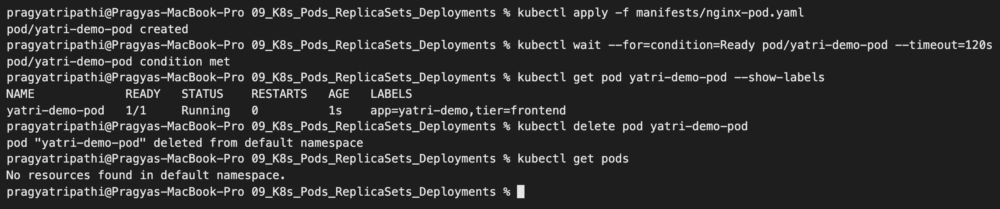
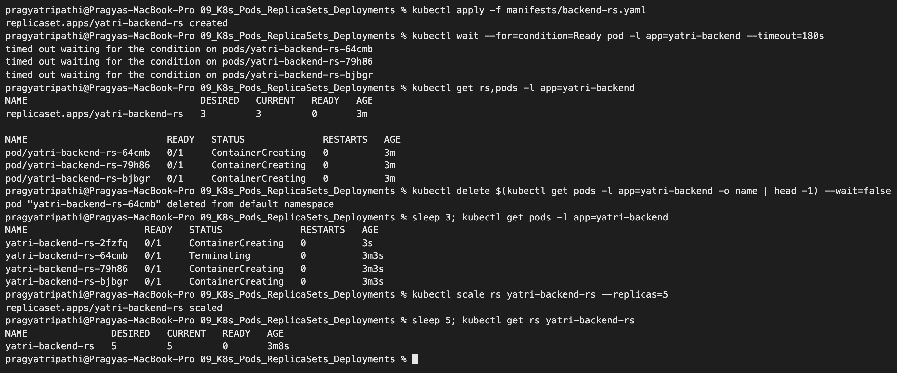
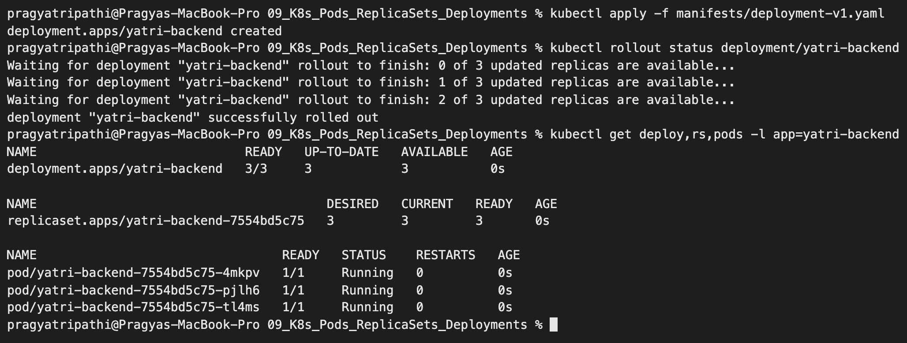
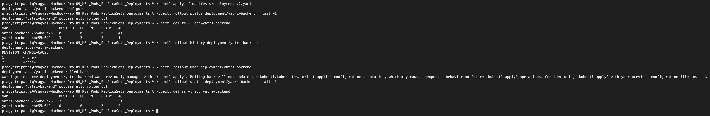
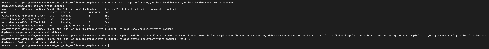
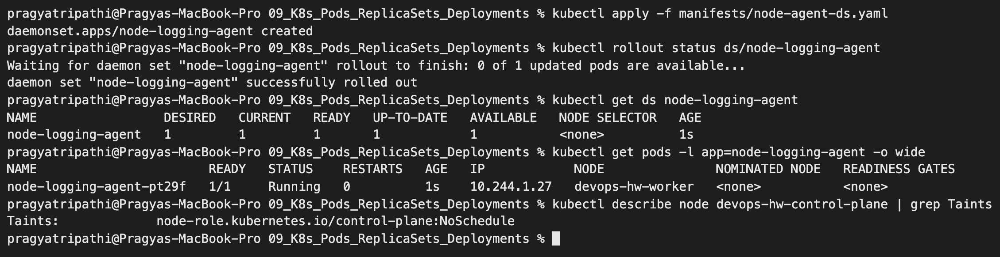

# Kubernetes Pods, ReplicaSets & Deployments – Homework

**Name:** Pragya Tripathi
**Roll No:** 24BCS10032

Manifests are from the class repository ([session10-k8s-core-objects](https://github.com/Nency-Ravaliya/devops-heros/tree/main/session10-k8s-core-objects)) and are copied into [manifests/](manifests). I ran them on my local 2-node kind cluster. All outputs are copied from my terminal.

| Object | What it adds |
|---|---|
| **Pod** | Smallest unit: one or more containers sharing an IP and volumes. If it dies, nothing brings it back |
| **ReplicaSet** | Keeps N copies of a Pod running at all times (self-healing, scaling) |
| **Deployment** | Manages ReplicaSets to give rolling updates, history and rollback |
| **DaemonSet** | Runs exactly one Pod on every (eligible) node |

---

*Screenshots below come from a second run of the same labs, so Pod names, IPs and ages differ from the text output.*

## 1. Pod

[manifests/nginx-pod.yaml](manifests/nginx-pod.yaml)

```text
$ kubectl apply -f pod/nginx-pod.yaml
pod/yatri-demo-pod created

$ kubectl wait --for=condition=Ready pod/yatri-demo-pod --timeout=120s
pod/yatri-demo-pod condition met

$ kubectl get pod yatri-demo-pod -o wide --show-labels
NAME             READY   STATUS    RESTARTS   AGE   IP           NODE               NOMINATED NODE   READINESS GATES   LABELS
yatri-demo-pod   1/1     Running   0          0s    10.244.1.3   devops-hw-worker   <none>           <none>            app=yatri-demo,tier=frontend

$ kubectl delete pod yatri-demo-pod
pod "yatri-demo-pod" deleted from default namespace

$ kubectl get pods
No resources found in default namespace.
```

**What I understood:** a bare Pod is not protected. After `kubectl delete pod` there were **no resources** left, nobody re-created it. That is why Pods are almost never created directly in production.

**Bare Pod: created, deleted, not re-created**




## 2. ReplicaSet – self-healing and scaling

[manifests/backend-rs.yaml](manifests/backend-rs.yaml) asks for `replicas: 3` with the selector `app=yatri-backend`.

```text
$ kubectl apply -f replicaset/backend-rs.yaml
replicaset.apps/yatri-backend-rs created

$ kubectl wait --for=condition=Ready pod -l app=yatri-backend --timeout=180s
pod/yatri-backend-rs-gtlsd condition met
pod/yatri-backend-rs-h7qnx condition met
pod/yatri-backend-rs-t856t condition met

$ kubectl get rs,pods -l app=yatri-backend -o wide
NAME                               DESIRED   CURRENT   READY   AGE   CONTAINERS   IMAGES               SELECTOR
replicaset.apps/yatri-backend-rs   3         3         3       13s   backend      python:3.11-alpine   app=yatri-backend

NAME                         READY   STATUS    RESTARTS   AGE   IP           NODE               NOMINATED NODE   READINESS GATES
pod/yatri-backend-rs-gtlsd   1/1     Running   0          13s   10.244.1.6   devops-hw-worker   <none>           <none>
pod/yatri-backend-rs-h7qnx   1/1     Running   0          13s   10.244.1.5   devops-hw-worker   <none>           <none>
pod/yatri-backend-rs-t856t   1/1     Running   0          13s   10.244.1.4   devops-hw-worker   <none>           <none>

$ kubectl delete pod yatri-backend-rs-gtlsd --wait=false
pod "yatri-backend-rs-gtlsd" deleted from default namespace

$ kubectl get pods -l app=yatri-backend
NAME                     READY   STATUS        RESTARTS   AGE
yatri-backend-rs-gtlsd   1/1     Terminating   0          16s
yatri-backend-rs-h7qnx   1/1     Running       0          16s
yatri-backend-rs-t856t   1/1     Running       0          16s
yatri-backend-rs-v52nh   1/1     Running       0          3s

$ kubectl scale rs yatri-backend-rs --replicas=5
replicaset.apps/yatri-backend-rs scaled

$ kubectl get rs yatri-backend-rs
NAME               DESIRED   CURRENT   READY   AGE
yatri-backend-rs   5         5         5       21s

$ kubectl describe rs yatri-backend-rs | sed -n "/^Events/,\$p"
Events:
  Type    Reason            Age   From                   Message
  ----    ------            ----  ----                   -------
  Normal  SuccessfulCreate  21s   replicaset-controller  Created pod: yatri-backend-rs-t856t
  Normal  SuccessfulCreate  21s   replicaset-controller  Created pod: yatri-backend-rs-h7qnx
  Normal  SuccessfulCreate  21s   replicaset-controller  Created pod: yatri-backend-rs-gtlsd
  Normal  SuccessfulCreate  8s    replicaset-controller  Created pod: yatri-backend-rs-v52nh
  Normal  SuccessfulCreate  5s    replicaset-controller  Created pod: yatri-backend-rs-vl7sp
  Normal  SuccessfulCreate  5s    replicaset-controller  Created pod: yatri-backend-rs-jk2sd

$ kubectl delete rs yatri-backend-rs
replicaset.apps "yatri-backend-rs" deleted from default namespace
```

**What I understood:**

- I deleted the Pod `yatri-backend-rs-gtlsd`. Within 3 seconds the ReplicaSet had already created a replacement (`yatri-backend-rs-v52nh`) while the old one was still terminating. The count never stays below 3.
- The ReplicaSet finds its Pods only through the **label selector**, and Pod names get a random suffix.
- `kubectl scale --replicas=5` created 2 more Pods. The `Events` list shows every `SuccessfulCreate`.
- A ReplicaSet cannot do a controlled image update. That is the job of a Deployment.

**ReplicaSet: self-healing after a Pod delete, then scaling to 5**




## 3. Deployment – rolling update, history, rollback

[manifests/deployment-v1.yaml](manifests/deployment-v1.yaml) → [manifests/deployment-v2.yaml](manifests/deployment-v2.yaml)

```text
$ kubectl apply -f deployment/deployment-v1.yaml
deployment.apps/yatri-backend created

$ kubectl rollout status deployment/yatri-backend --timeout=240s
Waiting for deployment "yatri-backend" rollout to finish: 0 of 3 updated replicas are available...
Waiting for deployment "yatri-backend" rollout to finish: 1 of 3 updated replicas are available...
Waiting for deployment "yatri-backend" rollout to finish: 2 of 3 updated replicas are available...
deployment "yatri-backend" successfully rolled out

$ kubectl get deploy,rs,pods -l app=yatri-backend
NAME                            READY   UP-TO-DATE   AVAILABLE   AGE
deployment.apps/yatri-backend   3/3     3            3           0s

NAME                                       DESIRED   CURRENT   READY   AGE
replicaset.apps/yatri-backend-7554bd5c75   3         3         3       0s

NAME                                 READY   STATUS    RESTARTS   AGE
pod/yatri-backend-7554bd5c75-nkgv9   1/1     Running   0          0s
pod/yatri-backend-7554bd5c75-qpgbl   1/1     Running   0          0s
pod/yatri-backend-7554bd5c75-zws4v   1/1     Running   0          0s

$ kubectl apply -f deployment/deployment-v2.yaml
deployment.apps/yatri-backend configured

$ kubectl annotate deployment/yatri-backend kubernetes.io/change-cause="Upgrade to v2.0.0" --overwrite
deployment.apps/yatri-backend annotated

$ kubectl rollout status deployment/yatri-backend --timeout=240s
Waiting for deployment "yatri-backend" rollout to finish: 1 out of 3 new replicas have been updated...
Waiting for deployment "yatri-backend" rollout to finish: 1 out of 3 new replicas have been updated...
Waiting for deployment "yatri-backend" rollout to finish: 1 out of 3 new replicas have been updated...
Waiting for deployment "yatri-backend" rollout to finish: 2 out of 3 new replicas have been updated...
Waiting for deployment "yatri-backend" rollout to finish: 2 out of 3 new replicas have been updated...
Waiting for deployment "yatri-backend" rollout to finish: 2 out of 3 new replicas have been updated...
Waiting for deployment "yatri-backend" rollout to finish: 1 old replicas are pending termination...
Waiting for deployment "yatri-backend" rollout to finish: 1 old replicas are pending termination...
deployment "yatri-backend" successfully rolled out

$ kubectl get rs -l app=yatri-backend
NAME                       DESIRED   CURRENT   READY   AGE
yatri-backend-7554bd5c75   0         0         0       2s
yatri-backend-cbc55c649    3         3         3       2s

$ kubectl get pods -l app=yatri-backend -L version
NAME                             READY   STATUS        RESTARTS   AGE   VERSION
yatri-backend-7554bd5c75-nkgv9   1/1     Terminating   0          2s    1.0.0
yatri-backend-7554bd5c75-qpgbl   1/1     Terminating   0          2s    1.0.0
yatri-backend-7554bd5c75-zws4v   1/1     Terminating   0          2s    1.0.0
yatri-backend-cbc55c649-54xz2    1/1     Running       0          1s    2.0.0
yatri-backend-cbc55c649-5p627    1/1     Running       0          2s    2.0.0
yatri-backend-cbc55c649-t2zll    1/1     Running       0          1s    2.0.0

$ kubectl rollout history deployment/yatri-backend
deployment.apps/yatri-backend
REVISION  CHANGE-CAUSE
1         <none>
2         Upgrade to v2.0.0

$ kubectl rollout undo deployment/yatri-backend
deployment.apps/yatri-backend rolled back

$ kubectl rollout status deployment/yatri-backend --timeout=240s | tail -1
deployment "yatri-backend" successfully rolled out

$ kubectl get rs -l app=yatri-backend
NAME                       DESIRED   CURRENT   READY   AGE
yatri-backend-7554bd5c75   3         3         3       3s
yatri-backend-cbc55c649    0         0         0       3s

$ kubectl rollout history deployment/yatri-backend
deployment.apps/yatri-backend
REVISION  CHANGE-CAUSE
2         Upgrade to v2.0.0
3         <none>

$ kubectl scale deployment yatri-backend --replicas=5
deployment.apps/yatri-backend scaled

$ kubectl rollout status deployment/yatri-backend --timeout=240s | tail -1
deployment "yatri-backend" successfully rolled out

$ kubectl get deploy yatri-backend
NAME            READY   UP-TO-DATE   AVAILABLE   AGE
yatri-backend   5/5     5            5           4s
```

**What I understood:**

- The chain is **Deployment → ReplicaSet → Pods**. The Pod name shows it: `yatri-backend` + ReplicaSet hash `7554bd5c75` + Pod suffix.
- Applying v2 created a **new ReplicaSet** (`cbc55c649`) and scaled it up while the old one (`7554bd5c75`) was scaled down to 0. `rollout status` shows it happening one replica at a time. With `maxSurge: 1` and `maxUnavailable: 0`, a new Pod must be ready before an old one is removed, so there is no downtime.
- The old ReplicaSet is kept with 0 replicas. That is what makes rollback instant: `kubectl rollout undo` simply scaled `7554bd5c75` back to 3.
- After the undo, revision 1 became revision 3 in `rollout history`. A rollback is recorded as a new revision.
- The `kubernetes.io/change-cause` annotation fills the `CHANGE-CAUSE` column, which is useful to know why a release was made.

**Deployment v1: Deployment → ReplicaSet → Pods**



**Rolling update to v2, history, and rollback**




## 4. Troubleshooting – a broken image

I pushed a wrong image tag on purpose, the same error as in `troubleshooting/broken-image.yaml`.

```text
$ kubectl set image deployment/yatri-backend backend=yatri-backend:non-existent-tag-v999
deployment.apps/yatri-backend image updated

$ kubectl get pods -l app=yatri-backend
NAME                             READY   STATUS             RESTARTS   AGE
yatri-backend-7554bd5c75-488vp   1/1     Running            0          27s
yatri-backend-7554bd5c75-kwpvr   1/1     Running            0          26s
yatri-backend-7554bd5c75-l6qxn   1/1     Running            0          26s
yatri-backend-7554bd5c75-nkgv9   1/1     Terminating        0          29s
yatri-backend-7554bd5c75-q4fkh   1/1     Running            0          27s
yatri-backend-7554bd5c75-qpgbl   1/1     Terminating        0          29s
yatri-backend-7554bd5c75-wjx89   1/1     Running            0          26s
yatri-backend-7554bd5c75-zws4v   1/1     Terminating        0          29s
yatri-backend-84f4d7dd5b-9pz89   0/1     ImagePullBackOff   0          25s
yatri-backend-cbc55c649-54xz2    1/1     Terminating        0          28s
yatri-backend-cbc55c649-5p627    1/1     Terminating        0          29s
yatri-backend-cbc55c649-t2zll    1/1     Terminating        0          28s

$ kubectl describe pod $(kubectl get pods -l app=yatri-backend --no-headers | grep -E "ImagePull|ErrImage" | head -1 | cut -d" " -f1) | grep -E "Failed|Back-off" | head -3
  Normal   BackOff    23s               kubelet            Back-off pulling image "yatri-backend:non-existent-tag-v999"
  Warning  Failed     23s               kubelet            Error: ImagePullBackOff
  Warning  Failed     7s (x2 over 23s)  kubelet            Failed to pull image "yatri-backend:non-existent-tag-v999": failed to pull and unpack image "docker.io/library/yatri-backend:non-existent-tag-v999": failed to resolve reference "docker.io/library/yatri-backend:non-existent-tag-v999": pull access denied, repository does not exist or may require authorization: server message: insufficient_scope: authorization failed

$ kubectl rollout undo deployment/yatri-backend
deployment.apps/yatri-backend rolled back

$ kubectl rollout status deployment/yatri-backend --timeout=240s | tail -1
deployment "yatri-backend" successfully rolled out

$ kubectl delete deployment yatri-backend
deployment.apps "yatri-backend" deleted from default namespace
```

**What I understood:**

- The new Pod went to `ImagePullBackOff`, and `kubectl describe pod` gave the exact reason: the image could not be pulled.
- The rolling update **protected the application**. All 5 old Pods stayed `Running` because the new Pod never became ready, so Kubernetes did not remove any more old ones.
- `kubectl rollout undo` brought the Deployment back to the healthy version.

Debugging order: `kubectl get pods` → `kubectl describe pod` (Events) → `kubectl logs` (add `--previous` for `CrashLoopBackOff`).

**Broken image: `ImagePullBackOff` while the old Pods keep running, then rollback**




## 5. DaemonSet

[manifests/node-agent-ds.yaml](manifests/node-agent-ds.yaml)

```text
$ kubectl apply -f daemonset/node-agent-ds.yaml
daemonset.apps/node-logging-agent created

$ kubectl rollout status ds/node-logging-agent --timeout=180s
Waiting for daemon set "node-logging-agent" rollout to finish: 0 of 1 updated pods are available...
daemon set "node-logging-agent" successfully rolled out

$ kubectl get ds node-logging-agent
NAME                 DESIRED   CURRENT   READY   UP-TO-DATE   AVAILABLE   NODE SELECTOR   AGE
node-logging-agent   1         1         1       1            1           <none>          2s

$ kubectl get pods -l app=node-logging-agent -o wide
NAME                       READY   STATUS    RESTARTS   AGE   IP            NODE               NOMINATED NODE   READINESS GATES
node-logging-agent-s2l4t   1/1     Running   0          2s    10.244.1.56   devops-hw-worker   <none>           <none>

$ kubectl describe node devops-hw-control-plane | grep Taints
Taints:             node-role.kubernetes.io/control-plane:NoSchedule

$ kubectl delete ds node-logging-agent
daemonset.apps "node-logging-agent" deleted from default namespace
```

**What I understood:** there is no `replicas` field. The number of Pods follows the number of nodes. `DESIRED` is 1 on my 2-node cluster because the control-plane node has a `NoSchedule` taint and this DaemonSet has no toleration for it, so only the worker node is eligible. Typical uses are log collectors, monitoring agents and network plugins. `kube-proxy` and `kindnet` are DaemonSets themselves.

---

**DaemonSet and the control-plane taint**




## Pod status cheat sheet

| Status | Meaning | First check |
|---|---|---|
| `Pending` | Not scheduled yet | `describe pod`: not enough CPU/memory, taints, unbound PVC |
| `ContainerCreating` | Pulling image or mounting volumes | Wait, then `describe pod` |
| `ImagePullBackOff` / `ErrImagePull` | Wrong image name/tag or no registry access | Image name, tag, pull secret |
| `CrashLoopBackOff` | Container starts and keeps crashing | `kubectl logs --previous` |
| `Running` but `0/1 READY` | Readiness probe failing | Probe path/port, application logs |
| `Completed` | Container finished with exit code 0 | Normal for Jobs |
| `Terminating` | Being shut down (grace period 30s by default) | – |

---

## Which workload type to use

| Need | Object | Why |
|---|---|---|
| A one-off debug container | bare **Pod** | No controller owns it, so nothing recreates it. Fine for `kubectl run -it --rm`, wrong for anything that must survive a node reboot. |
| N identical replicas, self-healing | **ReplicaSet** | Keeps a replica count. Rarely written by hand. |
| N replicas **plus** versioned updates and rollback | **Deployment** | Owns one ReplicaSet per revision. The default for stateless apps. |
| Exactly one Pod per node | **DaemonSet** | Node agents — log shippers, metrics exporters, CNI. Scales with the cluster, not with load. |
| Stable network identity and per-Pod storage | **StatefulSet** | Ordered names (`web-0`, `web-1`), stable DNS, one PVC per Pod. Databases, queues. |
| Run once to completion | **Job** | Retries until it succeeds, then stops. |
| Run to completion on a schedule | **CronJob** | Creates a Job per tick. |

---

# Session 10 deliverables

## Task 1: Deployment strategies

Manifests: [manifests/strategies](manifests/strategies). Everything runs in namespace `s10-strategies`. Each version serves a one-line page from a ConfigMap (`v1` or `v2`), so a `wget` tells me which Pod answered.

### Strategy comparison

| Strategy | Downtime | Both versions live at once | Extra resources | Rollback | Use when |
|---|---|---|---|---|---|
| **RollingUpdate** | None | Yes, briefly | `+maxSurge` Pods | `kubectl rollout undo`, gradual | Default for stateless apps |
| **Recreate** | Yes, a real gap | Never | None | Another full recreate | Two versions must never coexist (shared schema, exclusive lock) |
| **Blue-Green** | None | Yes, two full sets | 2x during the overlap | Instant — flip the Service label back | A risky release you want to abandon in one step |
| **Canary** | None | Yes, by replica ratio | `+canary` Pods | Scale the canary to 0 | You want real traffic on the new version before committing |

### 01. Rolling update

`maxSurge: 1` with `maxUnavailable: 0` means Kubernetes may add one extra Pod but may never drop below the 4 it already has.

```text
$ kubectl apply -f manifests/strategies/01-rolling-update.yaml
deployment.apps/web-rolling created

$ kubectl rollout status deployment/web-rolling -n s10-strategies --timeout=120s
Waiting for deployment "web-rolling" rollout to finish: 0 of 4 updated replicas are available...
Waiting for deployment "web-rolling" rollout to finish: 1 of 4 updated replicas are available...
Waiting for deployment "web-rolling" rollout to finish: 2 of 4 updated replicas are available...
Waiting for deployment "web-rolling" rollout to finish: 3 of 4 updated replicas are available...
deployment "web-rolling" successfully rolled out
```

Now the update, caught one second in:

```text
$ kubectl set image deployment/web-rolling web=nginx:1.28-alpine -n s10-strategies
deployment.apps/web-rolling image updated

$ kubectl get pods -n s10-strategies -l app=web-rolling
NAME                           READY   STATUS              RESTARTS   AGE
web-rolling-678b84d9db-glrrx   1/1     Running             0          12s
web-rolling-678b84d9db-l8n5p   1/1     Running             0          12s
web-rolling-678b84d9db-vv7hb   1/1     Running             0          12s
web-rolling-678b84d9db-zdll6   1/1     Running             0          12s
web-rolling-95f475bc-7m667     0/1     ContainerCreating   0          0s
```

**Five Pods.** All four of the old ones are still `Running` and serving while the first new one is still being created — that is `maxUnavailable: 0` doing its job. The rollout then walks through the set one at a time:

```text
$ kubectl rollout status deployment/web-rolling -n s10-strategies --timeout=120s
Waiting for deployment "web-rolling" rollout to finish: 1 out of 4 new replicas have been updated...
Waiting for deployment "web-rolling" rollout to finish: 2 out of 4 new replicas have been updated...
Waiting for deployment "web-rolling" rollout to finish: 3 out of 4 new replicas have been updated...
Waiting for deployment "web-rolling" rollout to finish: 1 old replicas are pending termination...
deployment "web-rolling" successfully rolled out

$ kubectl get rs -n s10-strategies -l app=web-rolling
NAME                     DESIRED   CURRENT   READY   AGE
web-rolling-678b84d9db   0         0         0       13s
web-rolling-95f475bc     4         4         4       1s
```

The old ReplicaSet is scaled to 0 but kept, which is what makes `rollout undo` instant.

### 02. Recreate

Same app, `strategy: type: Recreate`. The contrast is immediate:

```text
$ kubectl set image deployment/web-recreate web=nginx:1.28-alpine -n s10-strategies
deployment.apps/web-recreate image updated

$ kubectl get pods -n s10-strategies -l app=web-recreate
NAME                            READY   STATUS        RESTARTS   AGE
web-recreate-77584c894d-khskq   1/1     Terminating   0          1s
web-recreate-77584c894d-scqzg   1/1     Terminating   0          1s
web-recreate-77584c894d-w5zlp   1/1     Terminating   0          1s

$ kubectl rollout status deployment/web-recreate -n s10-strategies --timeout=120s
Waiting for deployment "web-recreate" rollout to finish: 0 out of 3 new replicas have been updated...
Waiting for deployment "web-recreate" rollout to finish: 0 of 3 updated replicas are available...
Waiting for deployment "web-recreate" rollout to finish: 1 of 3 updated replicas are available...
Waiting for deployment "web-recreate" rollout to finish: 2 of 3 updated replicas are available...
deployment "web-recreate" successfully rolled out
```

Every old Pod terminates **before** any new one starts, and `0 of 3 updated replicas are available` is the outage, visible in the rollout output. Nothing serves traffic during that window.

### 03. Blue-Green

Two complete Deployments, `web-blue` (v1) and `web-green` (v2), both labelled `app=web-bg` but differing on `version`. One Service picks the live set with its selector.

```text
$ kubectl get pods -n s10-strategies -l app=web-bg --show-labels
NAME                         READY   STATUS    RESTARTS   AGE   LABELS
web-blue-7b84d9f7f5-bg2jl    1/1     Running   0          1s    app=web-bg,pod-template-hash=7b84d9f7f5,version=blue
web-blue-7b84d9f7f5-jgcd7    1/1     Running   0          1s    app=web-bg,pod-template-hash=7b84d9f7f5,version=blue
web-green-67b9c77496-5mndp   1/1     Running   0          1s    app=web-bg,pod-template-hash=67b9c77496,version=green
web-green-67b9c77496-zj6lx   1/1     Running   0          1s    app=web-bg,pod-template-hash=67b9c77496,version=green

$ kubectl get endpoints web-bg -n s10-strategies
NAME     ENDPOINTS                       AGE
web-bg   10.244.1.17:80,10.244.1.18:80   1s
```

Four Pods exist, but the Service only lists **two** endpoints — the blue pair. Green is fully built and completely idle. Traffic before the cutover:

```text
$ for i in 1 2 3 4 5 6; do kubectl exec client -n s10-strategies -- wget -qO- web-bg; done
v1
v1
v1
v1
v1
v1
```

The cutover is one label edit:

```text
$ kubectl patch svc web-bg -n s10-strategies -p '{"spec":{"selector":{"app":"web-bg","version":"green"}}}'
service/web-bg patched

$ kubectl get endpoints web-bg -n s10-strategies
NAME     ENDPOINTS                       AGE
web-bg   10.244.1.19:80,10.244.1.20:80   14s

$ for i in 1 2 3 4 5 6; do kubectl exec client -n s10-strategies -- wget -qO- web-bg; done
v2
v2
v2
v2
v2
v2
```

The endpoint IPs changed from `.17/.18` to `.19/.20` and every response flipped to v2 at once. Rolling back is the same command with `blue` — the old Pods were never deleted, so it is instant.

### 04. Canary

`web-stable` (4 replicas, v1) and `web-canary` (1 replica, v2) share the label `app=web-canary`. The Service selects only that label, so both Deployments land behind it and the split is just the replica ratio.

```text
$ kubectl get pods -n s10-strategies -l app=web-canary -L track
NAME                          READY   STATUS    RESTARTS   AGE   TRACK
web-canary-5799c67d85-jznhd   1/1     Running   0          1s    canary
web-stable-6896bb95d6-bdbts   1/1     Running   0          1s    stable
web-stable-6896bb95d6-g6fqb   1/1     Running   0          1s    stable
web-stable-6896bb95d6-np6hz   1/1     Running   0          1s    stable
web-stable-6896bb95d6-wsq44   1/1     Running   0          1s    stable

$ kubectl get endpoints web-canary -n s10-strategies
NAME         ENDPOINTS                                                  AGE
web-canary   10.244.1.22:80,10.244.1.23:80,10.244.1.24:80 + 2 more...   1s

$ for i in $(seq 1 20); do kubectl exec client -n s10-strategies -- wget -qO- web-canary; done | sort | uniq -c
  15 v1
   5 v2
```

1 canary Pod out of 5 predicts 20% of requests; 20 requests gave **5 to v2 (25%)**. kube-proxy picks a backend at random per connection, so small samples scatter around the ratio rather than hitting it exactly. The lever is the replica count — 1 in 5, then 2 in 5, and so on. Getting a precise percentage regardless of replica count needs an ingress controller or a service mesh that can weight routes.

One trap worth recording: `kubectl port-forward svc/web-canary 8089:80` is **not** a valid way to check the split. Forwarding to a Service resolves its endpoints once and pins the tunnel to a single Pod, so every request goes to the same backend — mine landed on the canary and returned `v2` five times in a row, which looks like a 100% rollout.

```text
$ for i in 1 2 3 4 5; do curl -s http://localhost:8089; done
v2 v2 v2 v2 v2
```

The traffic split only appears through the Service's ClusterIP, which is why the test above runs `wget` from a Pod inside the cluster rather than from my laptop.

---

## Task 2: Pod lifecycle

Manifests: [manifests/lifecycle](manifests/lifecycle), namespace `s10-lifecycle`. Four Pods, each engineered to sit in a different state. `restartPolicy` is what decides whether a Pod can reach a terminal phase at all.

A Pod has exactly five phases: **Pending**, **Running**, **Succeeded**, **Failed**, **Unknown**. All four Pods at once:

```text
$ kubectl get pods -n s10-lifecycle -o custom-columns="NAME:.metadata.name,PHASE:.status.phase,RESTARTS:.status.containerStatuses[0].restartCount,WAITING-REASON:.status.containerStatuses[0].state.waiting.reason"
NAME                  PHASE       RESTARTS   WAITING-REASON
lifecycle-crashloop   Running     2          <none>
lifecycle-failed      Failed      0          <none>
lifecycle-pending     Pending     <none>     <none>
lifecycle-succeeded   Succeeded   0          <none>
```

### 1. Pending — accepted, but scheduled nowhere

The Pod requests 100 CPUs. Both nodes are real and neither has them, so the scheduler can never place it.

```text
$ kubectl describe pod lifecycle-pending -n s10-lifecycle | grep -A4 '^Events:'
Events:
  Type     Reason            Age                From               Message
  ----     ------            ----               ----               -------
  Warning  FailedScheduling  30s (x3 over 33s)  default-scheduler  0/2 nodes are available: 1 Insufficient cpu, 1 node(s) had untolerated taint(s). preemption: 0/2 nodes are available: 2 Preemption is not helpful for scheduling.
```

The message names both reasons at once: the worker has insufficient CPU, and the control-plane node is excluded by its taint. `Pending` means the API server stored the object but no kubelet has taken it — the container was never created, so `kubectl logs` has nothing to show.

### 2. Succeeded — ran and exited 0

```text
$ kubectl logs lifecycle-succeeded -n s10-lifecycle
work finished
```

`restartPolicy: Never` is what lets it settle here. With the default `Always` the kubelet would restart it and the phase would stay `Running` forever. `kubectl get pods` prints this one as `Completed`, which is the *container* wording for phase `Succeeded`.

### 3. Failed — exited non-zero

```text
$ kubectl get pod lifecycle-failed -n s10-lifecycle -o jsonpath='{.status.containerStatuses[0].state.terminated.exitCode}{"\n"}'
1
```

Same `restartPolicy: Never`, but a non-zero exit, so the phase is `Failed`. In the `get pods` column this shows as `Error`.

### 4. CrashLoopBackOff — not a phase

This is the one worth being precise about. `restartPolicy: Always` plus a container that exits 1 after two seconds:

```text
$ kubectl get pod lifecycle-crashloop -n s10-lifecycle -o custom-columns="NAME:.metadata.name,PHASE:.status.phase,RESTARTS:.status.containerStatuses[0].restartCount,WAITING-REASON:.status.containerStatuses[0].state.waiting.reason"
NAME                  PHASE     RESTARTS   WAITING-REASON
lifecycle-crashloop   Running   5          CrashLoopBackOff

$ kubectl get pod lifecycle-crashloop -n s10-lifecycle
NAME                  READY   STATUS             RESTARTS      AGE
lifecycle-crashloop   0/1     CrashLoopBackOff   5 (81s ago)   4m37s

$ kubectl describe pod lifecycle-crashloop -n s10-lifecycle | grep -E 'BackOff|Warning'
      Reason:       CrashLoopBackOff
  Warning  BackOff    0s (x6 over 4m30s)   kubelet            spec.containers{app}: Back-off restarting failed container app in pod lifecycle-crashloop_s10-lifecycle(de78fa17-7045-4d77-a6a0-c65f8349f040)
```

The `STATUS` column says `CrashLoopBackOff` but the **phase is `Running`**. CrashLoopBackOff is a *container* waiting reason, not a Pod phase — the Pod is alive and the kubelet is holding the container in a back-off timer before the next attempt. That is why `kubectl get pods` can be misleading: the `STATUS` column mixes phases (`Running`, `Pending`, `Completed`) with container reasons (`CrashLoopBackOff`, `ImagePullBackOff`, `Error`).

Polling for this state took about 100 seconds of attempts, because the back-off grows (10s, 20s, 40s, 80s, up to 5 minutes) and between timers the container is briefly `terminated` instead. `kubectl logs --previous` is the tool for reading why the last attempt died.

### Phase vs container reason

| What you see | What it is | Where it lives |
|---|---|---|
| `Pending`, `Running`, `Succeeded`, `Failed`, `Unknown` | Pod **phase** | `.status.phase` |
| `CrashLoopBackOff`, `ImagePullBackOff`, `ErrImagePull`, `ContainerCreating` | Container **waiting reason** | `.status.containerStatuses[].state.waiting.reason` |
| `Completed`, `Error`, `OOMKilled` | Container **terminated reason** | `.status.containerStatuses[].state.terminated.reason` |

### Clean up

```bash
kubectl delete namespace s10-strategies s10-lifecycle
```
